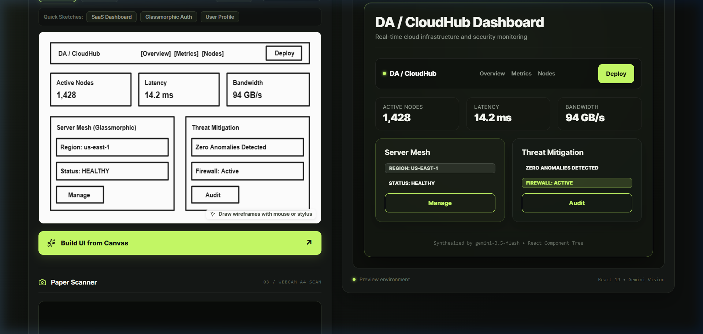
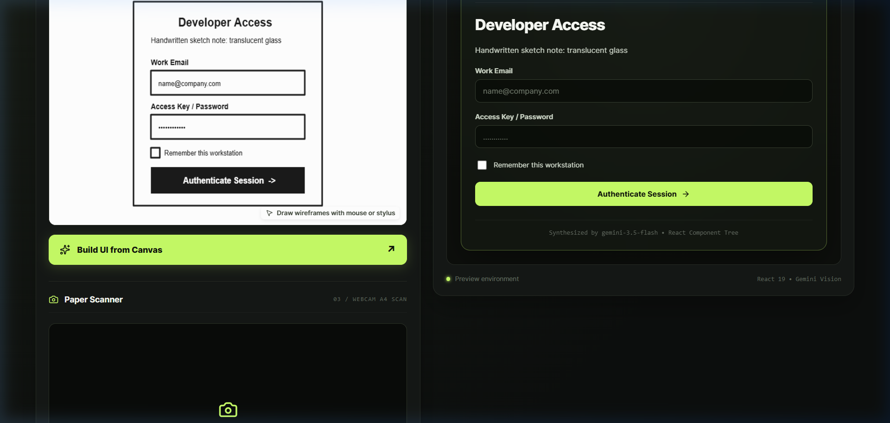
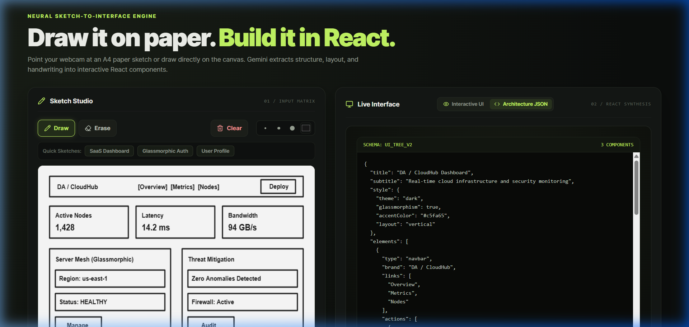

<div align="center">

# ✳ SketchFlow

**Convert hand-drawn UI wireframes and paper sketches into live, interactive React interfaces using Gemini Vision AI.**

[](https://opensource.org/licenses/MIT)
[](https://fastapi.tiangolo.com)
[](https://react.dev)
[](https://vitejs.dev)
[](https://aistudio.google.com)

[Overview](#-overview) • [Key Features](#-key-features) • [Architecture](#-architecture) • [Getting Started](#-getting-started) • [Webcam Guide](#-webcam-workflow--troubleshooting) • [API Reference](#-api-endpoints) • [License](#-license)

---

</div>

## 📸 Screenshots

| Hand-drawn Sketch to Cloud Dashboard | Glassmorphic Authentication Card |
| :---: | :---: |
|  |  |

<div align="center">
  <b>Component Tree Inspector:</b> View normalized JSON schemas alongside interactive components.
  <br/><br/>
  
</div>

---

## 💡 Overview

### Problem Statement
Product managers, designers, and developers frequently sketch interface concepts on physical paper (A4 sheets, napkins, whiteboards) or quick digital boards. Translating these rough sketches into real, functional front-end code is a tedious manual process that slows down rapid prototyping.

### The Solution
**SketchFlow** automates the transition from concept to code:
1. Point your laptop camera at an A4 paper sheet or draw on the built-in digital studio canvas.
2. The AI Vision pipeline extracts component types, hierarchical layout, handwritten notes, and spatial relationships.
3. A safe recursive React engine synthesizes live, responsive components with interactive state, translucent glassmorphism, and lime-accent design tokens in real time.

---

## ✨ Key Features

- **Digital Sketch Studio**: Canvas with Draw, Erase, Clear, brush stroke thickness presets (`2px`, `4px`, `8px`), and color picker.
- **Quick Sketch Presets**: Pre-drawn templates (`SaaS Dashboard`, `Glassmorphic Auth`, `User Profile`) to test the AI pipeline immediately with one click.
- **Webcam Paper Scanner**: Point a laptop camera directly at an A4 sketch sheet with live stream rendering and manual frame capture.
- **Auto-Stabilization Detector**: Real-time webcam stability tracking with configurable hold duration (`1.5s`, `2.0s`, `3.0s`) and visual progress bar. Frame triggers automatically once steady, preventing accidental or redundant API flooding.
- **Capture Frame Lifecycle**: Clear **Analyze & Build**, **Discard**, and post-error **Retry with captured image** controls.
- **Spatial Layout Preservation**: Side-by-side elements remain horizontally aligned in `row` or `grid` containers; stacked items maintain strict vertical order.
- **Handwritten Notes & Glassmorphism**: AI detects handwritten annotations (e.g., *"translucent glass"*, *"dark mode"*, *"lime accent"*) and applies backdrop blur and glowing CSS borders.
- **Interactive Component Registry**: Pure, safe React components with zero `eval()` or unvetted scripts:
  - Navigation bars with brand mark and action buttons
  - Responsive headings and typography
  - Stateful text inputs, password fields, and textareas with live typing
  - Action buttons with visual click feedback toasts
  - Multi-tab navigation with active state switching
  - Toggable checkboxes and option dropdowns
  - Telemetry metric stats with value and trend indicators
  - Curated Lucide React icons (`search`, `user`, `bell`, `settings`, `lock`, etc.)
- **Dual View Modes**: Switch seamlessly between **Interactive UI** and the **Architecture JSON** (`UI_TREE_V2`) component tree.
- **Offline Demo Mode**: Built-in toggle to test the full end-to-end interface generation even if offline or without internet access.

---

## 🏛 Architecture & Tech Stack

```
┌────────────────────────────────────────────────────────┐
│                   SketchFlow Client                    │
│    (React 19 + Vite + Lucide Icons + Pure CSS System)  │
└───────────────────────▲────────────────────────────────┘
                        │ HTTP JSON
                        ▼
┌────────────────────────────────────────────────────────┐
│                   FastAPI Backend                      │
│        (Uvicorn + Pydantic + Robust JSON Repair)       │
└───────────────────────▲────────────────────────────────┘
                        │ REST + inline_data
                        ▼
┌────────────────────────────────────────────────────────┐
│              Google Gemini Vision API                  │
│   (Primary: gemini-3.5-flash | Fallback: flash-lite)   │
└────────────────────────────────────────────────────────┘
```

- **Frontend**: React 19, Vite, Lucide React, HTML5 Canvas API (Pointer events & frame differencing).
- **Backend**: Python 3.10+, FastAPI, Uvicorn, Requests, Python-dotenv, Pydantic.
- **AI Model & Provider**:
  - Provider: **Google Gemini API** (Google Generative AI).
  - Primary Model: **`gemini-3.5-flash`** (High speed, vision capable, structured output).
  - Fallback Models: `gemini-3.5-flash-lite`, `gemini-3-flash-preview` (automatically retries if high-demand spikes or rate limits occur).
  - **Note**: This application uses the Google Gemini REST API. It **does not** require Ollama or local model weights. A valid `GEMINI_API_KEY` is required for live AI analysis.

---

## 🚀 Getting Started

### Prerequisites
- **Node.js**: v18.0.0 or higher
- **Python**: v3.10 or higher
- **Gemini API Key**: Obtain a free API key from [Google AI Studio](https://aistudio.google.com/).

---

### Step 1: Clone the Repository
```bash
git clone https://github.com/Darshan-S-0/sketchflow.git
cd sketchflow
```

---

### Step 2: Configure Environment Variables
Copy `.env.example` to `backend/.env`:
```powershell
# Windows PowerShell
Copy-Item .env.example backend\.env
```
Open `backend/.env` and replace `your_gemini_api_key_here` with your actual Gemini API key:
```ini
GEMINI_API_KEY=AIzaSy...your_actual_key...
GEMINI_MODEL=gemini-3.5-flash
```

> **Security Note**: Never commit `backend/.env` or expose your API key in version control. The backend strictly handles model calls and hides credentials from client requests.

---

### Step 3: Start the Backend (Terminal 1)

```powershell
# Windows PowerShell (from sketchflow project root)
cd backend

# Create virtual environment (if not already created)
python -m venv .venv

# Activate virtual environment
.\.venv\Scripts\Activate.ps1

# Install backend dependencies
python -m pip install -r requirements.txt

# Start the FastAPI server
python -m uvicorn main:app --host 127.0.0.1 --port 8000 --reload
```

The backend will start at: `http://127.0.0.1:8000`  
Health check endpoint: `http://127.0.0.1:8000/health`

---

### Step 4: Start the Frontend (Terminal 2)

```powershell
# Windows PowerShell (from sketchflow project root in a new terminal)
cd frontend

# Install dependencies
cmd /c npm install

# Start Vite dev server
cmd /c npm run dev
```

The frontend will start at: `http://localhost:5173`

Open `http://localhost:5173` in your browser. Verify the green status indicator shows:  
`ONLINE • GEMINI-3.5-FLASH`

---

## 🧪 Running Tests & Quality Checks

### Backend Test Suite
The backend includes an automated test suite verifying health checks, JSON markdown fence stripping, demo mode, and live Gemini vision parsing:
```powershell
cd backend
.\.venv\Scripts\python.exe test_backend.py
```

### Frontend Linting & Production Build
```powershell
cd frontend
cmd /c npm run lint
cmd /c npm run build
```

---

## 📷 Webcam Workflow & Troubleshooting

1. **Pointing at Paper**: Position your laptop webcam to point at an A4 paper sheet resting on your desk or held in your hands.
2. **Contrast & Pen**: Use a dark felt-tip pen or marker for best results. Faint pencil marks under dim lighting may be missed by vision models.
3. **Browser Permission**: When prompted by your browser, select **Allow** for camera access. If blocked, click the camera lock icon in your address bar and reset permissions.
4. **Auto-Detect Stabilization**: Check the **Auto-detect stable sketch** box. Hold the paper still for the configured interval (`1.5s`–`3.0s`). The green meter will track stability and automatically capture the frame.
5. **Analyze & Build**: Once captured, click **Analyze & Build UI** to send the frame to the Gemini pipeline.
6. **Retry with Captured Image**: If synthesis fails due to network spikes, click the **Retry with captured image** button to re-run without re-capturing.

---

## 📡 API Endpoints

### 1. Health Check
- **`GET /health`**
- **Response**:
```json
{
  "status": "ok",
  "api_key_configured": true,
  "primary_model": "gemini-3.5-flash",
  "available_models": ["gemini-3.5-flash", "gemini-3.5-flash-lite", "gemini-3-flash-preview"],
  "cors_origins": ["http://localhost:5173", "http://127.0.0.1:5173"]
}
```

### 2. Analyze Sketch
- **`POST /analyze`**
- **Payload**:
```json
{
  "image": "data:image/jpeg;base64,...",
  "test_mode": false
}
```
- **Response**:
```json
{
  "success": true,
  "ui": {
    "title": "Cloud Analytics Hub",
    "subtitle": "Real-time metrics & telemetry",
    "style": {
      "theme": "dark",
      "glassmorphism": true,
      "accentColor": "#c5fa65",
      "layout": "vertical"
    },
    "elements": [
      {
        "type": "navbar",
        "brand": "AetherPulse",
        "links": ["Overview", "Nodes", "Security"],
        "actions": [{"type": "button", "text": "Deploy", "variant": "primary"}]
      },
      {
        "type": "row",
        "children": [
          {"type": "stats", "label": "Nodes", "value": "1,428"},
          {"type": "stats", "label": "Latency", "value": "14.2ms"}
        ]
      }
    ]
  },
  "model": "gemini-3.5-flash",
  "is_demo": false
}
```

### 3. Demo Templates
- **`GET /templates`**
- Returns built-in mock templates for offline development (`dashboard`, `login`, `profile`).

---

## ⚠️ Known Limitations & Future Improvements

- **Webcam Resolution**: Built-in laptop webcams vary in optics; high-resolution external webcams or mobile camera streams produce sharper text recognition.
- **Handwriting Recognition**: Highly cursive or overlapping scribbles may be interpreted as generic layout cards rather than specific text labels.
- **Future Improvements**:
  - One-click export of synthesized interfaces to standalone JSX / Next.js / Tailwind code files.
  - Multi-page wireframe navigation flow support.
  - Integration with WebRTC for mobile-to-desktop camera streaming.

---

## 🤝 Contributing

Contributions, bug reports, and suggestions are welcome!
1. Fork the repository.
2. Create your feature branch (`git checkout -b feature/amazing-feature`).
3. Commit your changes (`git commit -m 'Add amazing feature'`).
4. Push to the branch (`git push origin feature/amazing-feature`).
5. Open a Pull Request.

Please ensure all frontend lint checks (`npm run lint`) and backend tests (`python backend/test_backend.py`) pass before submitting.

---

## 📄 License

Distributed under the **MIT License**. See [`LICENSE`](LICENSE) for complete details.

Copyright (c) 2026 SketchFlow Contributors.
